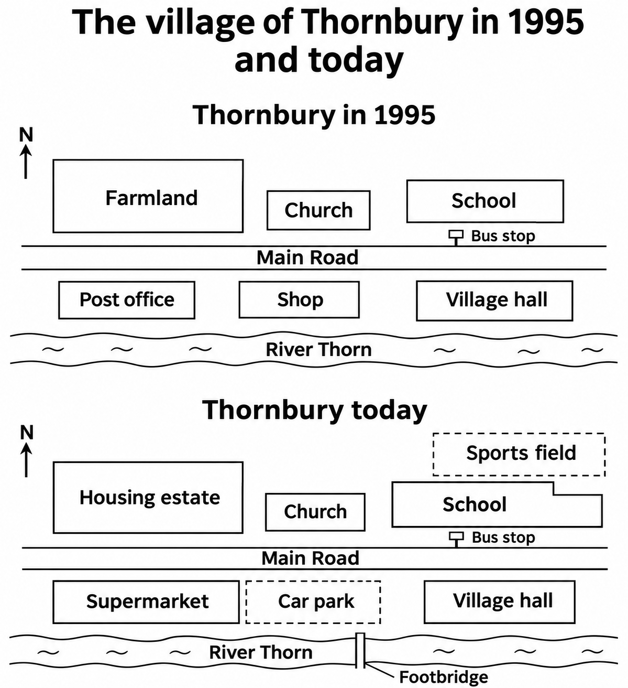
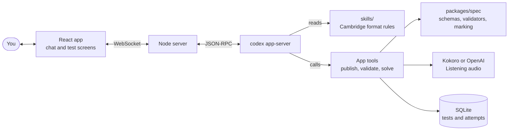

<p align="center">
  
</p>

<h1 align="center">IELTS Anything</h1>

<p align="center">
  <strong>Practise IELTS Academic on whatever you care about.</strong><br/>
  Type a topic. Get a test that looks, sounds and marks like a Cambridge IELTS paper.
</p>

---

Bored of reading about the history of the bicycle for the tenth time? Ask for a Reading test on **how frontier AI labs are governed**, a Listening test about **booking a climbing course**, a Writing task on **electric car sales since 2015**, or a Speaking interview about **the piece of technology you can't live without**. IELTS Anything writes it in the exact format of the Cambridge IELTS Academic books 12–21, checks it like an examiner would, lets you sit it in a screen modelled on computer-delivered IELTS, and gives you a band score with feedback you can act on.

It runs on your computer, on your own [Codex](https://developers.openai.com/codex) subscription. No accounts and no app servers: your tests, answers and recordings stay on your machine. Only Codex sees what it needs to write and mark your practice (and OpenAI's speech service sees Listening scripts, if you choose its voices).

## The four skills

| | What you get | How it is checked |
|---|---|---|
| **Reading** | Three passages and 40 questions (or a one-passage drill), in Cambridge register: TRUE/FALSE/NOT GIVEN, matching headings, summary completion and every other family. | Every answer needs an exact evidence quote from the passage. An independent solver sits the paper without the key; disputed items are fixed or justified before you see them. |
| **Listening** | Four recorded parts, 40 questions, about 30 minutes: a phone booking, a guided walk with a map, a student discussion, a lecture. A narrator, question-reading time and checking pauses, just like the real recording. | The script is validated (answers heard in order, with time to write), and the solver answers from the transcript. After the test you review it line by line, with the audio jumping to where each answer was said. |
| **Writing** | Task 1 (charts, tables, maps and process diagrams drawn from real data) and Task 2 (every Cambridge essay family). | Marked against the official public band descriptors, criterion by criterion, with your own sentences quoted as evidence and concrete corrections. |
| **Speaking** | A live interview with a voice examiner: Part 1 questions, a Part 2 cue card with a minute to prepare, a Part 3 discussion. | The examiner who heard you marks you against the official descriptors, pronunciation included. |

Every skill also comes as a **drill**: one passage, one part, one task, or one question type.

## Voices for Listening

Listening tests are recorded by the app after they are written, with a cast of different voices so the test sounds like real people:

- **Kokoro** (default): free, runs on your computer. Eight British voices and several American ones. The first test downloads a 90 MB voice model; a full test records in about ten minutes.
- **OpenAI** (optional, paid): add your own API key in Settings to use `gpt-4o-mini-tts`. More natural delivery, and it adds Australian and New Zealand accents. Roughly 40 cents per full test.

Take a test in **exam mode** (the recording plays once and cannot be paused) or **practice mode** (pause, rewind, replay any part).

## Drawn like the real thing

Writing Task 1 maps and process diagrams are drawn with image generation, in the black-and-white style of the Cambridge papers. The tutor studies these original reference drawings first, and every generated figure is checked against its data before you see it:

<p align="center">
  
  
</p>

Line graphs, bar charts, pie charts, tables and Listening maps are drawn by the app from data, so the numbers you describe are exactly the numbers the marker checks.

## Quick start

You need:

- **Node.js 22.13 or newer** (the app uses the built-in `node:sqlite`).
- **The Codex CLI**, signed in: `codex login`. The app reuses that login; it keeps its own Codex home in `~/.ielts-anything` so your coding history and memories stay separate.

```bash
git clone https://github.com/RyanNg1403/ielts-anything.git
cd ielts-anything
npm install
npm run dev
```

Open **http://127.0.0.1:5173** and type what you want to practise, for example *"A Listening test about volunteering in a nature reserve"*.

Speaking needs a microphone; Listening needs headphones or speakers.

## How it works



- The **tutor** is Codex, guided by the skills in [`skills/`](skills): one per job (writing passages, writing items, auditing keys, writing scripts, marking essays and speech). They encode the Cambridge format as concrete rules and measured frequencies.
- Codex never writes a test into the chat. It publishes through **app tools** that validate every passage, part or task against the format and send back errors to fix.
- **[`packages/spec`](packages/spec)** holds the shared schemas, the printed instructions (Cambridge wording), the validators, the narration and the marking. It is plain TypeScript with unit tests.
- Answers, scripts and Speaking questions stay on the server until you have taken the test.

## Project layout

```
apps/server     Node server: Codex bridge, app tools, marking, Listening audio, settings
apps/web        React app: chat, test screens, results, library, progress, settings
packages/spec   Shared schemas, validators, instructions, narration and marking (with tests)
skills          The tutor's skills, one folder each, with reference drawings for Writing
research        Format research: question-type frequencies, rules and their sources
spikes          Experiments behind the voice, marking and figure choices
docs            The build plan and UX notes
```

## Configuration

Most things are set in the app (Settings: appearance, Listening voices, OpenAI key). For development, these environment variables are read from `.env`:

| Variable | Default | What it does |
|---|---|---|
| `IELTS_HOME` | `~/.ielts-anything` | Where the app keeps its database, recordings, voice model and Codex home |
| `IELTS_MODEL`, `IELTS_EFFORT` | `gpt-6-luna`, `max` | The Codex model and thinking effort used unless you pick another in the composer |
| `IELTS_VOICE`, `IELTS_EXAMINER_VOICE` | `juniper`, `spruce` | Realtime voices for the spoken tutor and the Speaking examiner |
| `PORT` | `8787` | Server port (the web app proxies `/api` to it) |

## Development

```bash
npm test            # spec unit tests (validators, marking, narration)
npm run typecheck   # all three workspaces
npx tsx apps/server/scripts/render-listening.ts   # record the sample Listening drill to hear the voices
```

## A word on Cambridge and IELTS

IELTS Anything creates **Cambridge-format practice**, not official tests, and it is not affiliated with IELTS, the British Council, IDP or Cambridge University Press & Assessment. The format rules come from studying the retired papers in Cambridge IELTS 12–21; this repository publishes only counts, rules and paraphrases from that study, never the books, passages, scripts or audio. The band descriptors quoted in the marking skills are the official public versions. Band scores are estimates.

## License

MIT, as declared in `package.json`.
