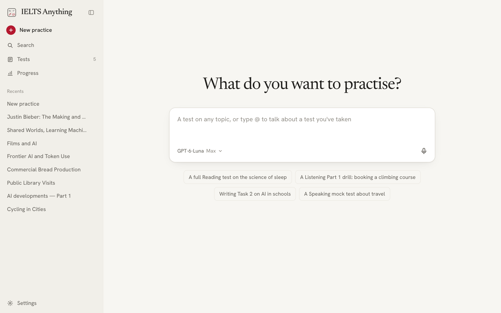
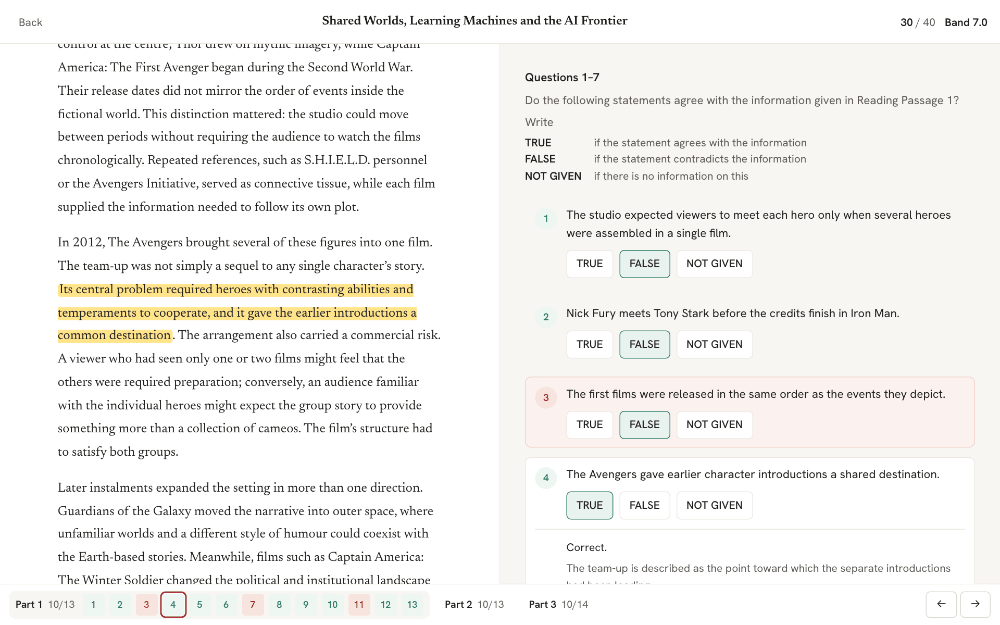
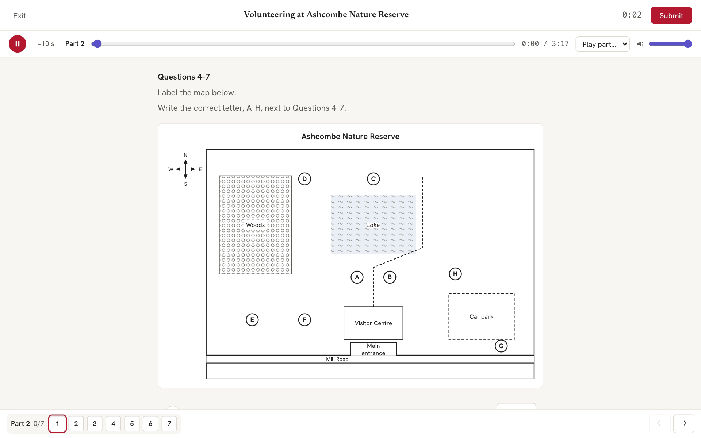
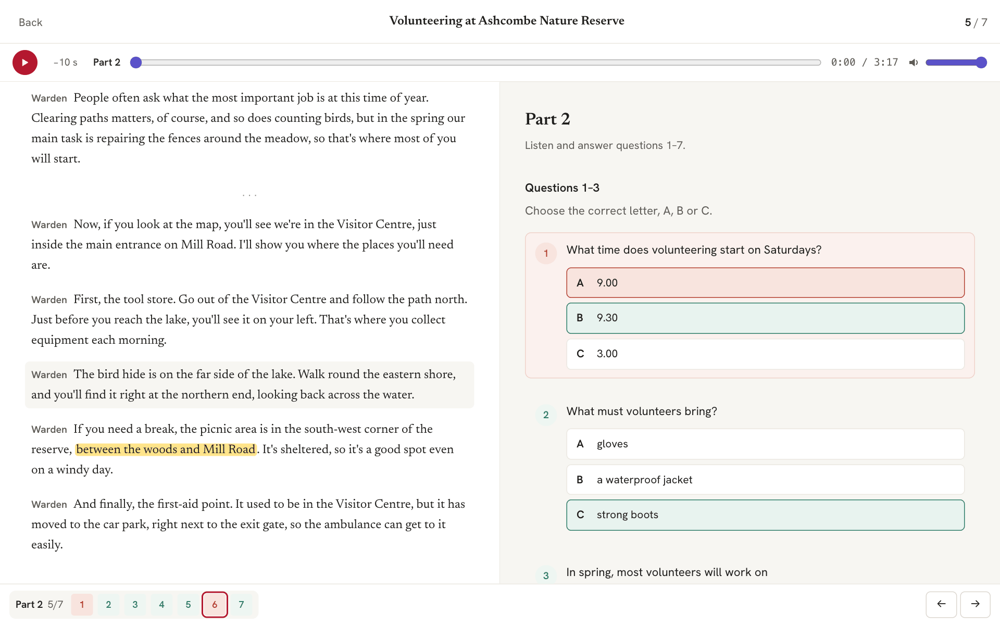
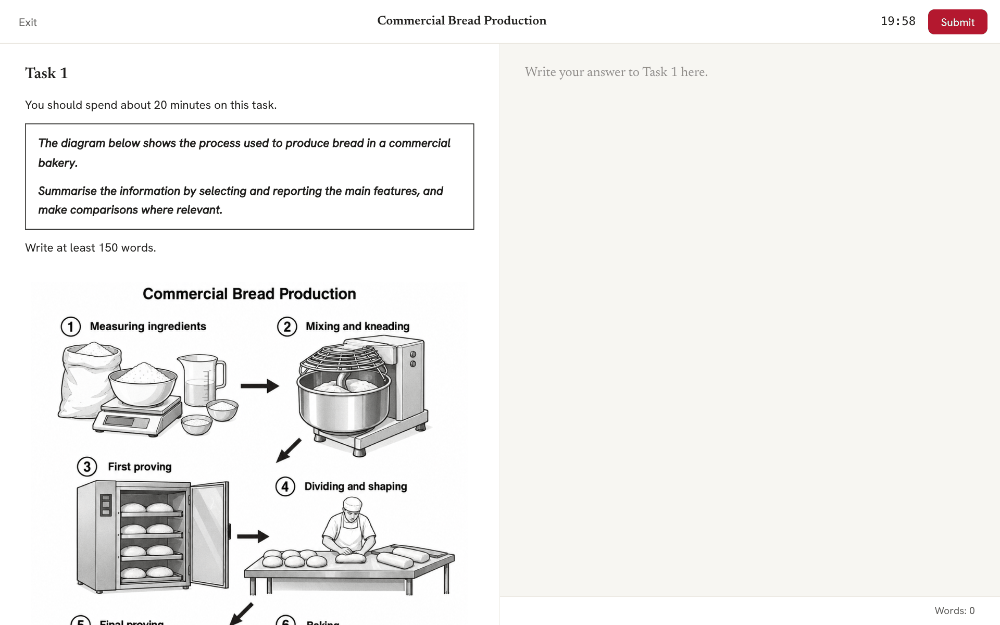
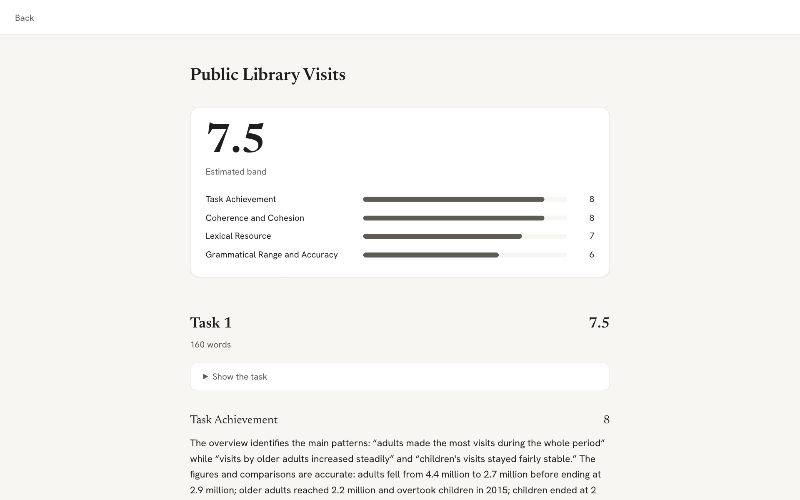
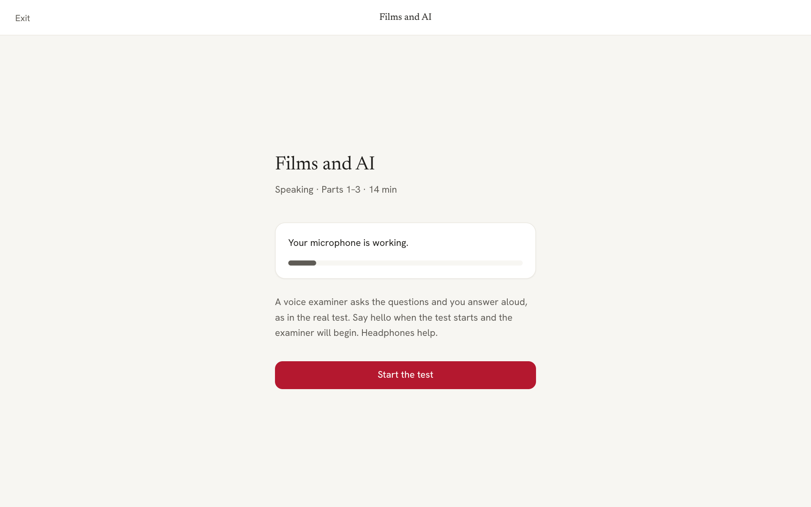
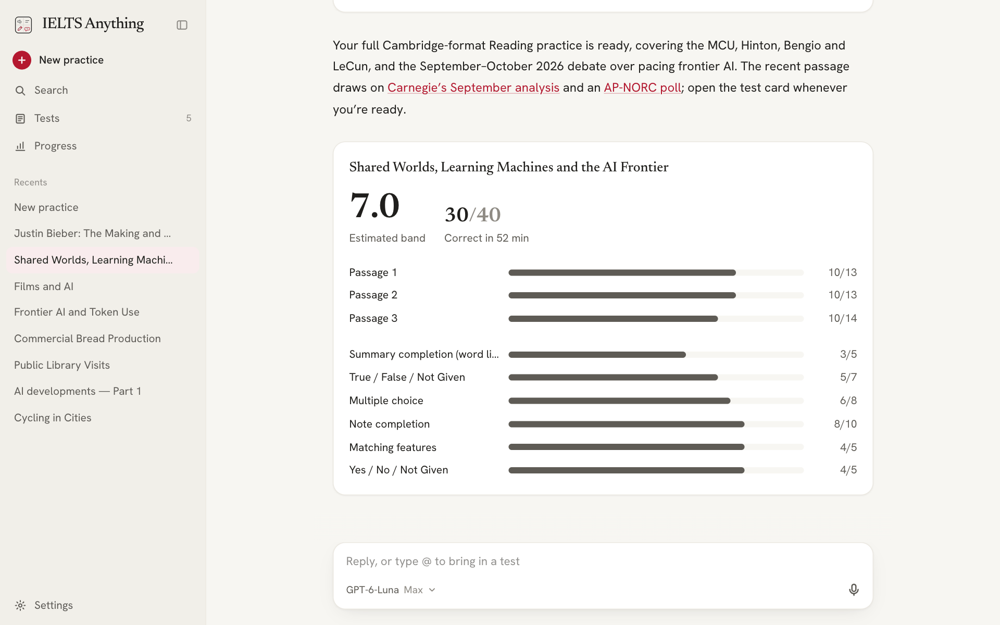
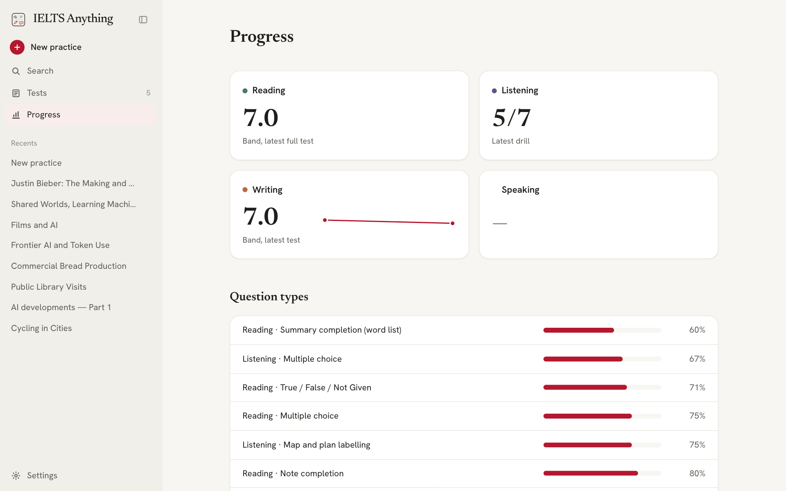
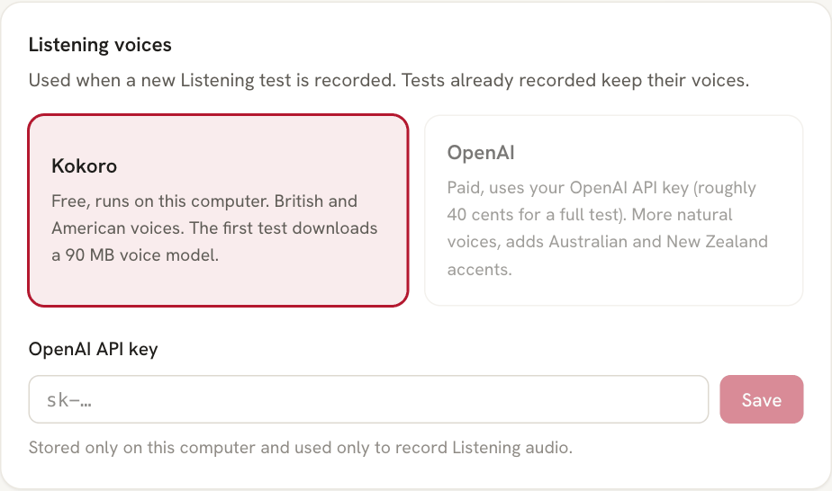

<p align="center">
  
</p>

<h1 align="center">IELTS Anything</h1>

<p align="center"><strong>IELTS practice about things you actually care about.</strong></p>

IELTS prep has a reputation: soil erosion, 18th-century canals, and a strange obsession with library opening hours. You could learn English that way. You could also learn to love dry toast.

IELTS Anything writes the test around *you*. Into football, K-pop, space or the latest AI drama? Type it in and get a proper Cambridge-format paper on it: same question types, same timing, same "is that FALSE or NOT GIVEN?" panic. It's still the exam, just about something you'd read anyway.

## Quickstart

```bash
git clone https://github.com/RyanNg1403/ielts-anything.git
cd ielts-anything && npm install && npm run dev
```

Open http://127.0.0.1:5173, type *"a Listening test about my favourite football club"*, and go make a cup of tea.

## What it does

**Ask for anything.** Pick a topic and a skill, a full test or a quick drill.



**Reading.** Three passages and 40 questions. A second AI sits each test blind first, and any question it argues with gets fixed. The review shows where each answer was hiding.



**Listening.** Four voiced parts with a narrator, forms and maps. Exam mode plays once, no mercy; practice mode lets you rewind as often as your pride allows.



**Listening review.** Click a question to hear the exact moment the answer flew past you.



**Writing.** Charts, maps and process diagrams for Task 1, essay questions you actually have opinions on for Task 2.



**Writing feedback.** Marked against the official band descriptors, criterion by criterion, quoting your own sentences back to you (lovingly).



**Speaking.** A live interview with a voice examiner who asks about your interests, not your hometown's buses for the fifth time.



**Chat with your tutor.** Scores land in the chat. Ask why question 7 was wrong, or for another test like that one but harder.



**Progress.** Bands over time, and which question types are your nemesis.



**Pick your voices.** Free local voices, or OpenAI's if you bring a key.



## Installation and details

**Requirements:** Node.js 22.13+ and the [Codex CLI](https://developers.openai.com/codex), signed in with `codex login`. The app runs on your own Codex subscription and keeps its data in `~/.ielts-anything`, separate from your coding history.

**Listening voices** (Settings):
- **Kokoro** (default): free and local, British and American voices. A 90 MB model downloads on first use.
- **OpenAI**: your own API key, `gpt-4o-mini-tts`. Adds Australian and New Zealand accents, about 40 cents per full test.

**How it works:** Codex writes each test following the rulebooks in [`skills/`](skills), and publishes it through app tools that check it against the Cambridge 12–21 format until it passes. [`packages/spec`](packages/spec) holds the schemas, checks and marking. Answers and scripts stay on the server until you submit.

```
apps/server     Codex bridge, app tools, marking, Listening audio
apps/web        Chat, test screens, results, progress, settings
packages/spec   Schemas, validators, marking (npm test)
skills          The tutor's rulebooks and Writing reference drawings
research        Format research and sources
```

**Environment overrides** (`.env`): `IELTS_HOME`, `IELTS_MODEL`, `IELTS_EFFORT`, `IELTS_VOICE`, `IELTS_EXAMINER_VOICE`, `PORT`.

**Development:** `npm test`, `npm run typecheck`, and `npx tsx apps/server/scripts/render-listening.ts` to hear the voices.

**The small print:** Cambridge-format practice, not official tests, and not affiliated with IELTS, the British Council, IDP or Cambridge. The repo contains only counts, rules and paraphrases from studying Cambridge IELTS 12–21, never the books, passages, scripts or audio. Band scores are estimates: great for practice, not for your visa officer. MIT licence.
