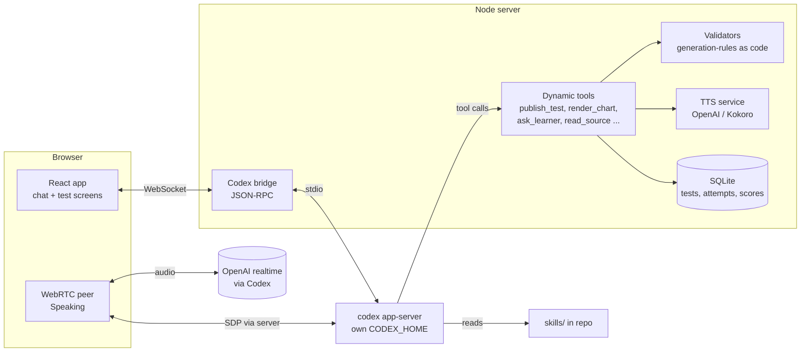
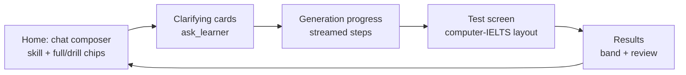

# ielts-anything: build plan

Status: **draft for approval**. Nothing is built yet.

## 1. What we are building

A local, open-source web app that turns any topic or source into IELTS Academic practice that looks and behaves like a Cambridge IELTS paper. It runs on the learner's own Codex subscription. Learners pick a skill (Reading, Listening, Writing, Speaking) and either a **full test** or a **focused drill** (one passage, one question type). They take it in a screen modelled on computer-delivered IELTS and get a band score with examiner-style feedback.

Settled decisions: Academic only, English UI, full tests and drills, computer-IELTS test screen, OpenAI TTS for Listening (Kokoro as free fallback), Codex realtime voice for Speaking, format rules from Cambridge 12–21 only.

## 2. Architecture

- **Codex bridge.** The server spawns `codex app-server` with its own `CODEX_HOME` (`~/.ielts-anything/codex`, reusing the user's login). That keeps IELTS threads out of the user's coding history and keeps their global AGENTS.md and memories out of the tests. Threads give us resume and history for free. The Codex version is pinned, because the realtime and user-input APIs are marked experimental.
- **Skills** live in the repo and are registered with `skills/extraRoots/set`, so cloning the repo is the whole install.
- **Dynamic tools** (`dynamicTools` on `thread/start`) are how Codex drives the UI and hands over results. Codex never emits a test as free text. It calls `publish_test` with a typed spec. The server validates it against the rules and returns any errors so Codex can repair the test before the learner sees it.
- **Storage:** SQLite for tests, attempts, answers, scores and generated assets (audio, charts, images on disk).

## 3. The test spec and validation (the core of "Cambridge fidelity")

Every generated test is one JSON document (zod schema, shared by server and UI): passages or scripts, question blocks (`family`, number range, exact instruction text, word cap, options), answer key with accepted alternatives, an **evidence record** per item (source span or script line, why each distractor fails), and assets (chart spec, map spec, audio).

The validators turn `research/ielts/generation-rules.md` into code. They check what can be checked deterministically:
- **Structure:** 40 questions, numbering with no gaps, Reading passage boundaries, Listening 4×10.
- **Block size:** each block's answer count matches its question range.
- **Instruction wording:** must match the Cambridge templates for each question family.
- **Answer format:** word caps, and option letters must exist.
- **Key coverage:** a TFNG/YNNG block with three or more items uses all three labels, with no forced ratio.
- **Answer order:** questions follow passage or script order where the family requires it.
- **Evidence:** each answer appears verbatim in the passage or script, within the word limit.

What code cannot check goes to a separate **solver pass**: a fresh Codex turn answers the test from the candidate view only, and any item it gets wrong or finds ambiguous is sent back for repair.

## 4. Agent skills (several per IELTS skill)

| Area | Skills |
|---|---|
| Shared | `ielts-core` (format facts, Cambridge register, question-family catalogue), `source-to-brief` (turns any source into a topic brief written up in Cambridge-academic register) |
| Reading | `reading-passage-writer`, `reading-item-writer` (one section per question family), `reading-key-auditor` |
| Listening | `listening-script-writer` (Part 1–4 patterns, distractors, answer pacing from the Cambridge audioscripts), `listening-item-writer`, `listening-audio-director` (speakers, voices, accents, pauses) |
| Writing | `task1-visual-designer` (chart, table, process or map spec plus prompt), `task2-prompt-writer`, `writing-examiner` (grader, from the writing-assessment research and calibration set) |
| Speaking | `speaking-examiner` (live interview script and pacing), `speaking-assessor` |

The skills contain paraphrased rules and statistics only. No Cambridge text ships in the repo.

**Source tools** feed `source-to-brief`. Each is a dynamic tool:
- `read_codex_thread`: read-only, from the user's normal `~/.codex`.
- `read_local_project`: README, file tree and key files, size-capped.
- `read_url`, `read_pdf`: read a web page or a PDF.
- `read_notes`: pasted text.

New sources are easy to add later (YouTube transcript, RSS, GitHub repo).

## 5. Per-skill pipelines

- **Reading:** brief → 3 passages, getting harder from 1 to 3, about 650–1,000 words each and genre-mixed → question blocks following the Cambridge position mix → validators → solver pass → publish. Drill: one passage plus one chosen family.
- **Listening:** brief → four scripts that follow the Cambridge audioscript patterns (Part 1 roughly 700 words of real back-and-forth, answers embedded, self-corrections as distractors) → items → validators → audio. Audio is rendered line by line with OpenAI `gpt-4o-mini-tts` (a British/Australian/American mix, male and female), then stitched with preview and check pauses. A transcription check confirms that every keyed word is audible.
- **Writing:** Task 1 visuals are drawn from a data spec by our own components: line, bar, pie, table, mixed, process diagram and map/plan. They are not image-generated, so the numbers are exact. Task 2 prompts come from the five Cambridge question families. Grading runs `writing-examiner` and returns a band per criterion, quoted evidence and corrections.
- **Speaking:** WebRTC session with a Codex realtime voice (v3, 9 voices) acting as examiner for Parts 1–3, with timed Part 2 prep. The transcript then goes to `speaking-assessor`. Pronunciation is marked as an **estimate**, since the grader only sees text.
- **Images:** Codex image generation is used only for decorative illustrations (Reading header art, Listening scene art). Exam visuals are drawn by code.

## 6. UI and user journey

- **Sidebar, kept minimal:**
  - "New practice" button.
  - **Library:** past tests and attempts, grouped by skill, showing the band.
  - **Sources:** connected threads, projects and URLs.
  - **Settings:** voice provider, OpenAI key, Codex status.
- **Chat:** Codex replies can contain generated cards (question cards, a topic brief preview, chart previews, a "Start test" card), rendered from tool calls.
- **Test screen:**
  - **All skills:** timer, question navigator, flag for review, highlighting.
  - **Reading:** split pane, passage left and questions right.
  - **Listening:** plays once in exam mode, with a practice mode that allows replay.
  - **Writing:** editor with a live word count.
  - **Speaking:** recording indicator and a Part 2 prep timer.
- **Results:** overall band and the band for each part. Each wrong item shows the evidence span from the passage or script. Writing and Speaking show feedback per criterion.
- **Visual direction:** education-inspired and modern. Warm paper background, deep ink-blue primary, one accent colour per skill, a serif for reading passages and a clean sans for the interface. Polish comes from careful typography rather than heavy decoration. I'll run the frontend-design skill at build time and show you screenshots.

## 7. Stack

TypeScript throughout: **Vite + React** front end, **Node (Hono) + ws** server, **zod** schemas shared by both, **SQLite** (better-sqlite3), Vitest and Playwright for tests. Kokoro runs as an optional Python sidecar. Repo layout: `apps/web`, `apps/server`, `packages/spec` (schemas and validators), `skills/`, `research/` (kept), `corpus/` (gitignored).

## 8. Milestones

| # | Milestone | Done when |
|---|---|---|
| M0 | Skeleton: server ↔ app-server bridge, chat streaming, dynamic tools, skills loaded, design system | A chat message reaches Codex, which calls a dynamic tool that renders a card in the UI |
| M1 | **Reading end-to-end** (full and drill) | Generate a test on a custom topic → validators and solver pass → take it in the split-pane screen → band and evidence review |
| M2 | Writing (Task 1 visuals, Task 2, grader) | All 7 visual types render from a spec; grader checked against the calibration scripts |
| M3 | Listening (scripts, TTS, player, maps) | 4-part test with audio; transcription check passes; map labelling works |
| M4 | Speaking (WebRTC examiner, assessor) | Live 3-part interview, transcript, band per criterion |
| M5 | Source tools, Library/Progress, polish, README and demo | Make a Reading test from a Codex thread; demo video for the hackathon |

Reading comes first because it has the most format rules and needs no audio. Each milestone ends with a screenshot review and your sign-off before commit.

## 9. Risks

- **Experimental APIs** (realtime, request_user_input) may change: pin the Codex version. Use our own `ask_learner` dynamic tool for clarifying questions rather than relying on `request_user_input`.
- **Generation time:** a full Reading test at high effort may take several minutes. Stream progress steps and generate passages in parallel threads.
- **Quality:** validators catch format errors, not difficulty. We will claim "Cambridge-format practice", never "equivalent to a real test".
- **Copyright:** the corpus stays local and gitignored. Skills and research carry only paraphrases, counts and short phrases.
- **Research numbers:** Codex is re-running the Cambridge Reading statistics, because the review found counting errors (§10). The skills will use the corrected figures.

## 10. Research status

- Done: exam construction rules (`research/ielts/*.md`, `generation-rules.md`), writing assessment (`research/ielts/writing-assessment/`), and the Cambridge 12–21 corpus profile (`research/ielts/cambridge/`).
- Correcting: the Reading passage-position table and the TFNG/YNNG answer splits. For example, C19 Test 1 Q1–7 is recorded as 9 answers. Codex is recounting with a script, a per-question CSV and block-sum assertions.

## 11. Decisions for you

1. Approve the stack (§7) and milestone order (§8)?
2. Licence: MIT?
3. Initialise git in `ielts-anything/` with local commits only (no remote until you say)?
